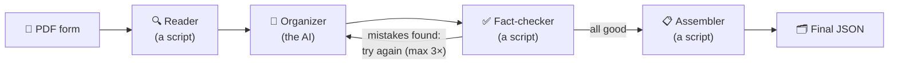
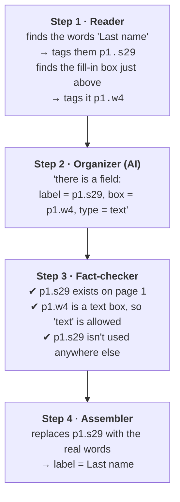
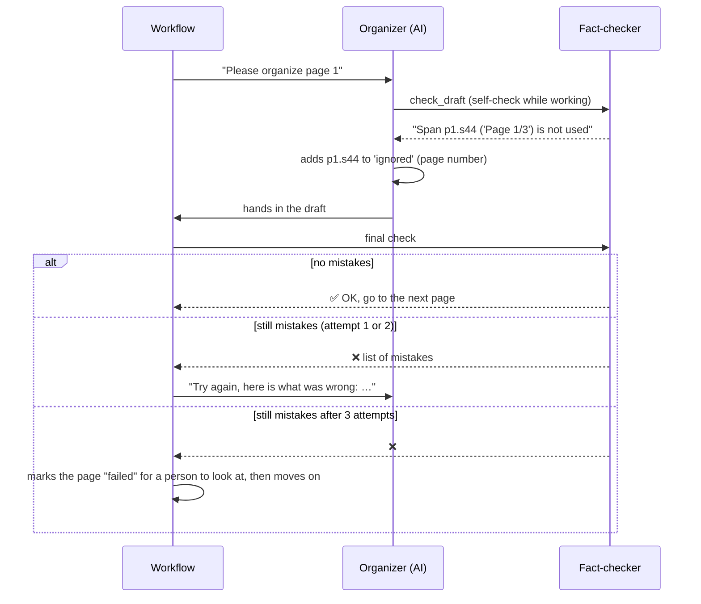
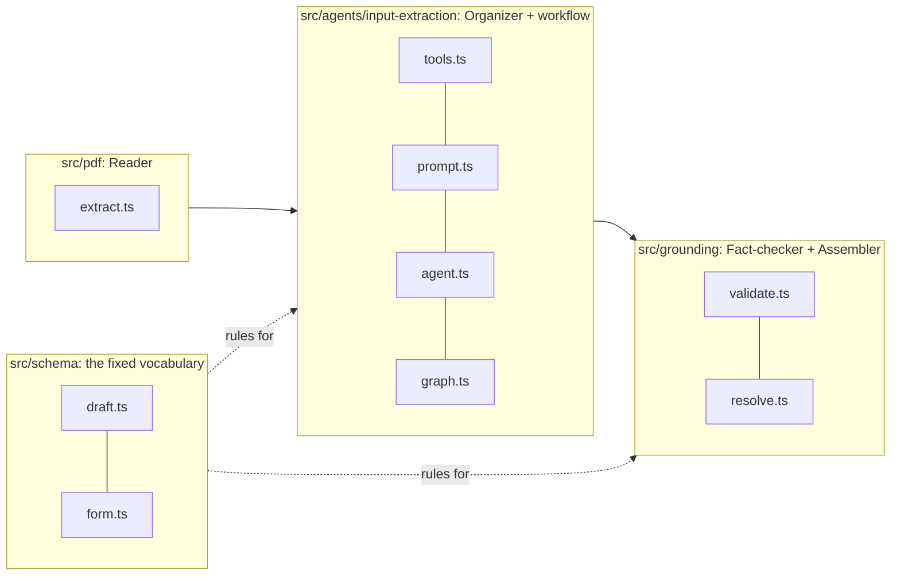
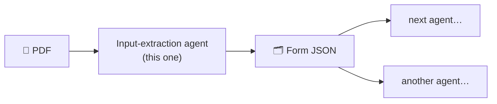

# How the Forms Analysis Agent Works

This explains the system in plain language. You don't need to know how to code to follow it.

---

## 1. The big picture

We give the system a **PDF form**, for example *"Payment of UBS Fisca 3a in the event of death"*. It gives back a **structured description** of that form as a JSON file. The description lists every section, every paragraph, and every box a person has to fill in, with the exact wording printed on the page.

Four workers handle each form, in this order:



| Worker | Who | What it does |
|---|---|---|
| **Reader** | a script (no AI) | Reads every word, fill-in box and drawn line on the page, and gives each one a **numbered tag**. |
| **Organizer** | the AI | Looks at the tagged items and decides how they fit together: "this is a heading", "this label belongs to that box". |
| **Fact-checker** | a script (no AI) | Checks the AI's work: every tag exists, nothing was skipped, nothing was used twice, the box types match. |
| **Assembler** | a script (no AI) | Swaps every tag for the exact text from the PDF and writes the final file. |

The AI does only one thing: it **organizes**. The other three steps are ordinary, predictable code.

---

## 2. Why the AI never types any text

If you ask an AI to copy a form, it can make small mistakes. It might drop a word, fix a "typo" that wasn't one, reword a sentence, or invent text that isn't there. For forms, that isn't acceptable.

So the AI **isn't allowed to write text at all.** It can only **point**.

> **Analogy:** You put numbered sticky notes on every word of a printed form. Then you ask an assistant to tell you how the form is organized, but they may only answer with sticky-note numbers ("heading = note 27, first box label = note 29"). Afterwards, a clerk copies the words under those notes into the final document. Since the assistant never writes a word, they can't misspell one or make one up.

That is what we mean by **grounded**: every word in the output can be traced back to a specific spot on the PDF.

---

## 3. Following one label all the way through

Let's follow the box labelled **"Last name"** on page 1 of the event-of-death form.



### Step 1: the Reader tags everything

The Reader goes through page 1 and lists what it finds. Here is a small part of its real output:

```
p1.s27 | Details of the deceased pension holder   ← bold heading
p1.s28 | 1                                        ← tiny footnote number
p1.s29 | Last name                                ← a label
p1.s30 | First name(s)                            ← another label, same row
p1.s36 | Marital status
p1.w4  | text box      (just above "Last name")
p1.w11 | dropdown box  options: Single; Married; Divorced; Widowed; …
p1.r5  | a drawn line  (the underline above "Last name")
```

How to read a tag like `p1.s29`:
- `p1` = page 1
- `s` = **s**pan, a piece of text. `w` = **w**idget, a fill-in box. `r` = **r**ule, a drawn line.
- `29` = its position, counting from the top of the page.

### Step 2: the AI organizes

The AI reads that list and answers with a **draft** made only of tags:

```json
{
  "region": "body",
  "title": "p1.s27",
  "items": [
    { "kind": "field",
      "field": { "label": "p1.s29", "field_type": "text", "input": "p1.w4", … } },
    { "kind": "field",
      "field": { "label": "p1.s36", "field_type": "dropdown", "input": "p1.w11",
                 "options": ["p1.w11.o1", "p1.w11.o2", "…"] } }
  ]
}
```

It also lists what it is deliberately leaving out, and why. For example, the footnote number `p1.s28` is left out because it is a *footnote marker*, and "Page 1/3" because it is a *page number*.

### Step 3: the Fact-checker checks

The Fact-checker is strict. It refuses the draft if:
- a tag doesn't exist, or belongs to another page,
- any piece of text on the page is **neither used nor deliberately left out** (nothing can be quietly skipped),
- a piece of text is used twice,
- a fill-in box is never used,
- the AI calls a box a "dropdown" when the PDF says it's a plain text box,
- the dropdown choices don't match the PDF's choices exactly,
- a field is marked **required** but the AI can't point to the text that says so, such as "(mandatory field)".

### Step 4: the Assembler writes the final result

Every tag is replaced with the real words from the PDF:

```json
{ "kind": "field", "label": "Last name", "field_type": "text", "input": "widget", … }
{ "kind": "field", "label": "Marital status", "field_type": "dropdown",
  "options": ["Single", "Married", "Divorced", "Widowed", "registered partnership",
              "diss.partnership, death", "diss.partnership, legal"] }
```

---

## 4. The "try again" loop

The AI doesn't always get it right first time. It can check its own work *while* working, using a tool called `check_draft`. A final, independent check also runs after it hands in its answer.



Pages are handled **one at a time**. This keeps each job small, so the AI only has to focus on one page.

---

## 5. What a person still needs to check

The scripts can prove that every **word** is real and nothing was skipped. Some decisions are judgment calls, and no script can prove those. They are listed in the output's **review list** as *warnings*:

| Warning | What it means | Example |
|---|---|---|
| `W_TYPE_INFERRED` | The AI guessed the type of box. The PDF didn't say. | On page 3, "Signature of beneficiary" has only a drawn line, no real box, so "signature" is the AI's reading. |
| `W_NO_INPUT` | The AI found a label but no box to write in. | "OU ref." in the "For internal bank use only" strip on page 3. |
| `W_LABEL_FAR_FROM_INPUT` | The AI paired a label with a box that is quite far away (over 150pt). | |
| `W_NORMALIZED` | The text was tidied in a small, known way. | "main-" at the end of a line + "taining" on the next line → "maintaining". |

---

## 6. Where everything lives (folder map)



| Folder / file | In everyday words | Step |
|---|---|---|
| `src/pdf/` | Reads the PDF and tags every word, box and line. | Reader |
| `src/schema/draft.ts` | The **only** answer format the AI may use: tags, never text. | Organizer's rules |
| `src/schema/form.ts` | The **fixed list of names** used in the final file, so it's always `title` and never `section_title` in one file and `section_heading` in another. | Final output's rules |
| `src/agents/input-extraction/tools.ts` | The six "tools" the AI may use: look at a page, look at the lines, find what's next to something, search for words, check its draft. | Organizer |
| `src/agents/input-extraction/prompt.ts` | The written instructions given to the AI. | Organizer |
| `src/agents/input-extraction/agent.ts` | Connects the AI to its tools and its answer format. | Organizer |
| `src/agents/input-extraction/graph.ts` | The workflow: which step runs after which, and the "try again" loop. | All |
| `src/grounding/validate.ts` | The Fact-checker. | Fact-checker |
| `src/grounding/resolve.ts` + `normalize.ts` | Swaps tags for real text, with a few small and clearly listed tidy-ups. | Assembler |
| `src/config/model.ts` | Says which AI service to use (Azure OpenAI). It's the only place that mentions it. | Setup |
| `src/cli/` | Commands to run things by hand: `dump-page` shows what the Reader sees, `extract` runs everything. | Tools for people |
| `tests/` | Automatic checks that the scripts work. One is a hand-made "perfect answer" for the sample form that must pass every check. | Quality |

---

## 7. Adding more agents later

This is the first of several agents. Each future agent will get its own folder under `src/agents/`, and will take the **final JSON from this one** as its input:



Because the JSON always uses the same fixed names, the next agents can rely on its shape.

---

## 8. Glossary

| Word | Meaning |
|---|---|
| **Span** | A piece of text on one line of the page, in one style. Tag: `p1.s29`. |
| **Widget** | A fill-in box built into an interactive PDF. Tag: `p1.w4`. Its dropdown choices are tagged `p1.w11.o1`, `p1.w11.o2`, … |
| **Rule** | A line drawn on the page. On a non-interactive (printed) form, the underline is often the fill-in box. Tag: `p1.r5`. |
| **AcroForm** | An interactive PDF with real fill-in boxes (widgets). A *static* PDF only has printed lines. |
| **Draft** | The AI's answer for one page, made only of tags. |
| **Schema** | A fixed template that says which names and values are allowed. Anything else is rejected. |
| **Agent** | An AI that can use tools in a loop (look, think, check, fix) before answering. |
| **Tool** | A small, reliable function the AI may call, such as "show me page 1". |
| **Graph / workflow** | The map of steps and the order they run in, including the "try again" loop. |
| **Grounded** | Every word in the output can be traced back to an exact place in the PDF. |
